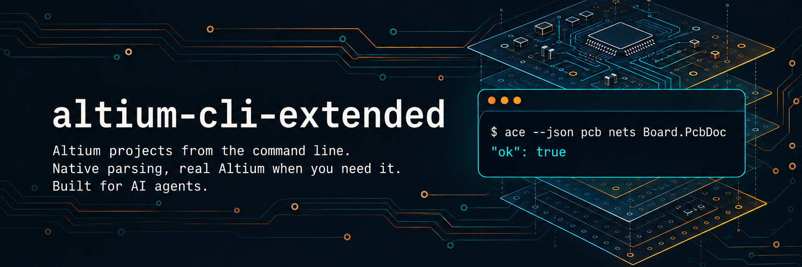

<p align="center"></p>

# altium-cli-extended

<p align="center">
  <a href="https://github.com/Hybirdss/altium-cli-extended/actions/workflows/ci.yml"></a>
  <a href="https://github.com/Hybirdss/altium-cli-extended/releases"></a>
  <a href="LICENSE"></a>
</p>

> Working with KiCad 10? See the companion tool **[kicad-cli-extended (`kce`)](https://github.com/Hybirdss/kicad-cli-extended)**.

Altium Designer ships no official CLI — it is a Windows GUI that runs as `X2.EXE` — so `ace` is a native Rust parser and editor for `.PrjPcb`, `.SchDoc`, `.PcbDoc`, `.SchLib` and `.PcbLib` files, plus a bridge to a real, user-licensed Altium Designer (local Windows, Windows over SSH, or Wine).

The native side covers `.OutJob` files too and needs no Altium installed: one small binary, on Windows,
macOS and Linux. The designer side is a bridge, not a reimplementation — it drives your own Altium
Designer when a task needs Altium's engine (compile, ERC, DRC, Gerber/ODB++/PDF/STEP outputs, any
process or script).

Every command prints one JSON envelope, every failure has a stable error code and a hint, and
`ace commands` describes the whole surface, so an agent can work without guessing.

## Install

**Prebuilt binaries** from [GitHub Releases](https://github.com/Hybirdss/altium-cli-extended/releases):

| OS | archive | binary |
|---|---|---|
| Windows x64 | `altium-cli-extended-x86_64-pc-windows-msvc.zip` | `ace.exe` |
| macOS Apple silicon | `altium-cli-extended-aarch64-apple-darwin.tar.gz` | `ace` |
| macOS Intel | `altium-cli-extended-x86_64-apple-darwin.tar.gz` | `ace` |
| Linux x86_64 | `altium-cli-extended-x86_64-unknown-linux-gnu.tar.gz` | `ace` |
| Linux arm64 | `altium-cli-extended-aarch64-unknown-linux-gnu.tar.gz` | `ace` |

Each archive has a matching `<archive>.sha256` file (`shasum -a 256 -c` on macOS and Linux, `Get-FileHash` on Windows). The archive holds the binary, `README.md`, `LICENSE`, `NOTICE` and the `skills/` folder. Unpack it and put the binary on your `PATH`:

```powershell
# Windows (PowerShell)
Expand-Archive altium-cli-extended-x86_64-pc-windows-msvc.zip -DestinationPath $env:LOCALAPPDATA\altium-cli-extended
$userPath = [Environment]::GetEnvironmentVariable("Path", "User")
[Environment]::SetEnvironmentVariable("Path", "$userPath;$env:LOCALAPPDATA\altium-cli-extended", "User")
$env:Path += ";$env:LOCALAPPDATA\altium-cli-extended"
ace.exe doctor --quick
```

```bash
# macOS / Linux
mkdir -p altium-cli-extended && tar xzf altium-cli-extended-*.tar.gz -C altium-cli-extended
sudo mv altium-cli-extended/ace /usr/local/bin/
ace doctor --quick
```

The macOS binaries are unsigned. After verifying the archive checksum, if Gatekeeper
blocks `ace`, remove its quarantine attribute with `xattr -d com.apple.quarantine /usr/local/bin/ace`.

**From source** (Rust 1.89 or newer):

```bash
cargo install --locked --git https://github.com/Hybirdss/altium-cli-extended altium-cli-extended
```

Check native readiness without contacting a host: `ace doctor --quick`. Run `ace doctor` when you need the full Designer probe.

## Quickstart

```bash
ace inspect Board.PrjPcb                          # what is this project
ace bom Board.PrjPcb --out bom.csv                # grouped BOM; --variant <name> for a variant
ace netlist Board.PrjPcb --where name=GND         # one net and its pins
ace check Board.PrjPcb                            # annotation, footprints, schematic vs PCB
ace diff Board.PrjPcb --rev HEAD~1                # vs the previous commit (project in a git repo)
ace pcb rules Board.PcbDoc --kind Clearance --units mil
ace sch set-param Power.SchDoc R5 MPN RC0603FR-0710KL --dry-run
ace pcblib list Footprints.PcbLib --where mount=smd --fields name,pads
ace pcblib rename Footprints.PcbLib SOIC-8 SOIC-8N --dry-run
```

Every example is a real command whose path, flags and return shape `ace describe` prints; file names
are placeholders for your own design.

Shape any list with `--fields`, `--where` (`key=value`, `key!=value`, `key~regex`,
`key^=substring`) and `--limit`. Lengths are mm unless `--units mil|raw`; the environment
variables `ACE_UNITS` and `ACE_CODEPAGE` set the defaults of `--units` and `--codepage`.

## Workflows

Start from what you want to do. Each section below is a chain of real commands. `$P` is the project,
`$B` its board, `$S` a sheet, `$R` a report directory outside the source; all are placeholders for your
own absolute paths (a bare `Board.PrjPcb` run from inside its folder cannot find sheets
that live above it, such as `..\Utils\*.SchDoc`).

| you want to | first command | section |
|---|---|---|
| review a project someone sent you, without Altium | `ace project find <dir>` | [Review a contractor's handover](#review-a-contractors-handover) |
| see what changed between two revisions | `ace diff A.PrjPcb B.PrjPcb --summary` | [Compare revisions](#compare-revisions) |
| fail a build or block a release on the design | `ace check P.PrjPcb --fail-on error` | [Gate a design in CI](#gate-a-design-in-ci) |
| change a value, add a variant, adjust a rule | `ace sch set-param ... --dry-run` | [Apply an ECO](#apply-an-eco-without-opening-altium) |
| rename or replace a footprint | `ace pcblib rename ... --dry-run` | [Rename a footprint](#rename-a-footprint-without-stale-references) |
| answer "what is on this pin or net" | `ace sch locate P.PrjPcb U1` | [Find parts, nets, and library footprints](#find-parts-nets-and-library-footprints) |
| produce Gerbers, run compile, ERC, DRC | `ace designer ping --timeout 60` | [Prepare a release with Designer](#prepare-a-release-with-designer) |
| undo a bad edit or unstick Altium | `ace restore F --from first --dry-run` | [Recover an edit or unstick Designer](#recover-an-edit-or-unstick-designer) |
| move a design to KiCad | `ace check P.PrjPcb --fail-on error` | [Altium to KiCad](#altium-to-kicad) |

An AI agent gets the same chains, with trigger phrases and what to verify, from `ace skill install`.


## Review a contractor's handover

Choose the project from discovery, then use absolute paths. Store reports outside the source.
The read-only guard blocks write and control commands before file or Designer access.

```bash
ace project find /absolute/handover --depth 6
P=/absolute/handover/Board.PrjPcb
B=/absolute/handover/Board.PcbDoc
R=/absolute/review
mkdir -p "$R"
export ACE_READONLY=1
ace inspect "$P"
ace project documents "$P" --fields rel,kind,exists
ace sch hierarchy "$P"
ace pcb info "$B"
ace bom "$P" --group-by designator --out "$R/parts.csv"
ace bom "$P" --source pcb --limit 1
ace netlist "$P" --out "$R/source.net"
ace check "$P" --severity warning --require MPN
ace pcb svg "$B" --out "$R/board.svg"
```

Read `ace check --list` for what each finding `code` means and how to fix it, and report by code, not
only by `passed`. Read `missing_documents`, `incomplete`, and the declared/found sheet counts before using a BOM.
Adopt the codepage from `meta.suggest.codepage` or a warning, then repeat exports with
`ACE_CODEPAGE` set. Reconcile schematic and PCB part counts. Native results leave compile,
ERC, DRC, and fabrication outputs unverified.

## Compare revisions

```bash
ace diff /absolute/RevA/Board.PrjPcb /absolute/RevB/Board.PrjPcb --summary
ace diff /absolute/RevA/Board.PrjPcb /absolute/RevB/Board.PrjPcb --by part --ignore-field '^param:ComponentLink'
ace diff /absolute/RevA/Board.PrjPcb /absolute/RevB/Board.PrjPcb --where change=part_added --fields ref
ace diff /absolute/RevA/Board.PcbDoc /absolute/RevB/Board.PcbDoc --geometry
ace diff "$P" --rev HEAD~1 --source pcb
```

Read the summary first, then open only the rows that matter with `--where` and `--fields`. Parts
match by unique ID before designator, so an annotation pass shows as `part_renamed` and keeps any
parameter change made at the same time. `identical:true` on the schematics says nothing about the
board; run the PCB diff too. Project diff compares variants and settings alongside the selected
design; run `--source pcb` separately for PCB rules and placement. Library diff compares decoded
fields and geometry, with explicit exclusions for unknown streams and embedded model payload bytes.
`--rev` compares against the nearest enclosing git repository and needs committed dependencies.

## Gate a design in CI

```bash
ace check "$P" --list
ace check "$P" --pcb "$B" --require MPN,Manufacturer --fail-on error > "$R/check.json"
ace diff "$P" --rev HEAD~1 --exit-code
ace check "$P" --pcb "$B" --require MPN,Manufacturer --baseline "$R/check.json" --fail-on error
```

`check --fail-on error` and `diff --exit-code` keep normal JSON on stdout and exit 9 when their
gate matches. Archive the envelope even on exit 9. With a baseline, check gates count only new
findings, which suits a board that already carries known findings: baselines require an unshaped,
complete check envelope with the same check options and board. Exit codes 10, 11 and 12 mean the
Altium host is missing, failed or busy; they say nothing about the design.

## Apply an ECO without opening Altium

```bash
ace check "$P" --pcb "$B" > "$R/before.json"
unset ACE_READONLY
ace sch locate "$P" R20,BF1
ace sch set-param /absolute/handover/Power.SchDoc R20 Value 22K --dry-run
ace sch set-param /absolute/handover/Power.SchDoc R20 Value 22K
ace project add-variant "$P" NoBuzzer --dry-run
ace project add-variant "$P" NoBuzzer
ace project set-variation "$P" NoBuzzer BF1
ace bom "$P" --variant NoBuzzer --group-by designator --limit 0
ace pcb set-rule "$B" Clearance gap 0.2mm --dry-run
ace pcb set-rule "$B" Clearance gap 0.2mm
ace check "$P" --pcb "$B" --baseline "$R/before.json" --fail-on error
ace diff "$P" --rev HEAD --by part
```

Use the sheet returned by `sch locate`. Read `changes[].before` in each dry run: `=Value` is a link,
so edit its Value parameter, and replacing a linked comment requires `--literal`. Rule lengths need
a unit. The PCB keeps the old comment and footprint until you run Update PCB in Altium, so expect
`comment-mismatch` rather than treating it as a failed edit. Keep a separate project copy for
multi-file work: there is no project checkpoint or transaction.

## Rename a footprint without stale references

```bash
ace sch find "$S" SOIC-8
ace pcb components "$B" --where footprint=SOIC-8 --fields designator,footprint
ace pcblib copy /absolute/Target.PcbLib /absolute/Source.PcbLib SOIC-8 --name SOIC-8N --dry-run
ace pcblib rename /absolute/Target.PcbLib SOIC-8 SOIC-8N --dry-run
ace sch set-footprint "$S" U3 SOIC-8N --dry-run
ace diff /absolute/before/Target.PcbLib /absolute/Target.PcbLib
```

List a footprint's users before renaming it. `pcblib copy` takes the destination first, and a rename
changes the library only: sheets, SchLib defaults and the PCB keep the old name. `sch set-footprint`
takes one designator per call; the PCB-side pattern needs Altium.

## Recover an edit or unstick Designer

```bash
ace restore "$S" --from first --dry-run
ace restore "$S" --from first
ace designer status
ace designer dialogs
ace designer screenshot --out /tmp/designer.png
ace designer jobs --last 3
```

Native writes keep the first `.bak`. `first` means the oldest preserved `.bak`, not the last edit.
`ace restore FILE --from first --dry-run` validates it and reports both sizes and modification times.
Omit `--dry-run` to restore one file after saving its current bytes to `<file>.pre-restore`, even with
`--no-backup`. An existing recovery copy blocks replacement; archive it before another restore.
For a stuck Altium, read the dialog and screenshot before `ace designer reset`, and treat a timed-out
result as not verified.

## Prepare a release with Designer

```bash
ace doctor --quick
ace designer status
ace designer ping --timeout 60
ace designer compile "$P" --timeout 300
ace designer erc "$P" --timeout 300
ace designer drc "$B" --timeout 300
ace designer pcb info "$B"
ace outjob outputs /absolute/Release.OutJob
ace outjob mediums /absolute/Release.OutJob
ace designer outjob "$P" /absolute/Release.OutJob
```

Stop on compile errors, ERC errors, DRC findings, or unrouted connections before exporting.
Use a fresh staging directory. Check every required output's kind, size, and hash before
publishing your archive. A successful command alone does not approve the release. This CLI
does not yet provide an atomic release transaction or a required-output manifest.
For SSH setup, read `ace describe designer config` and `ace designer setup`.

On PowerShell, use an argument array for paths with spaces and check the process exit explicitly:

```powershell
$AceArgs = @('--json', '--read-only')
$Project = 'C:\Designs\My Board\Board.PrjPcb'
& ace.exe @AceArgs check $Project --fail-on error
if ($LASTEXITCODE -ne 0) { exit $LASTEXITCODE }
```

## Find parts, nets, and library footprints

```bash
ace sch locate "$P" R20,BF1
ace netlist "$P" --pins --where designator=R20
ace sch pins /absolute/handover/Power.SchDoc --component R20 --project "$P" --unconnected --fields pin,name,net
ace pcblib find 0603 /absolute/libraries --pads
ace sch component "$S" R20 --project "$P"
ace pcb lengths "$B" --fields net,routed_length,vias --limit 20
ace pcb info "$B"
ace pcb stackup "$B"
ace pcb rules "$B" --where kind^=Clearance
```

Use `pin` for a pin number. Unconnected pin rows have `net:null` and `connected:false`.
Read library search `skipped` and `incomplete` before treating a zero count as absence.
IntLib extraction needs Altium. `--kind Clearance` selects exactly that rule kind;
`--where kind^=Clearance` searches kind names containing Clearance. `stackup` gives the physical stack.

## Altium to KiCad

Freeze a copy of the source and record a recursive file/hash manifest outside both projects.
Import into an explicit target path: `--project` alone does not select the import output.

```bash
kce project new /tmp/target --name target
kce --json --project /tmp/target pcb import /absolute/source/Board.PcbDoc --format altium --output /tmp/target/target.kicad_pcb --report-format json --report-file /tmp/import.json
kce --json --project /tmp/target pcb info
```

Read back the exact target board: require the reported path to equal
`/tmp/target/target.kicad_pcb`, inspect the imported footprints and compare its hash with the
empty board. Recompute the source manifest including file additions and deletions; require
it to be identical. Stop if the board is still empty. A successful board import is not a
verified migration: symbol/library conversion and independent electrical equivalence still
need separate evidence. Keep the source oracle outside the KiCad project so restore cannot
remove it. Discover supported KiCad steps with `kce --help` before continuing.

## Native and designer backends

| | native | designer |
|---|---|---|
| needs | nothing | a licensed Altium Designer |
| runs on | Windows, macOS, Linux | see hosts below |
| does | read everything, BOM, netlist, checks, diffs, previews, byte-safe edits | compile, ERC, DRC, output jobs, any Altium process, DelphiScript |

Designer hosts:

- **Local Windows** (default): Altium Designer installed on the same machine, with a logged-in
  desktop session. The interactive runner uses `conhost --headless` on Windows 10 1809 or newer.
  Run `ace designer setup` to inspect the prerequisites and register the per-user scheduled task
  with `ace designer setup --apply runner` as that desktop user when prompted. The task runs
  at Limited privilege; registration does not require an elevated shell.
- **Remote Windows over SSH**: run `ace` anywhere (macOS, Linux, another PC) and drive Altium
  on a Windows machine or VM you can SSH into; projects are synced there and back. ace uses
  `StrictHostKeyChecking=yes` with `~/.ssh/known_hosts_altium`: unknown or changed keys are
  refused. Verify the server fingerprint through a trusted channel and pin the matching key
  in that file before setup; the first connection never silently trusts a new key.
- **Wine on Linux** (optional): Altium Designer under Wine.

`ace doctor` reports what is usable; `ace designer setup` lists the remaining setup steps
for the configured host, with who has to do each one.

Known limitation: designer jobs leave projects open in Altium. The job's `.PrjPcb` and the
bridge and job script projects (`AltiumCliBridge.PrjScr`, `Job.PrjScr`) stay in the Projects
panel, and a board that DRC ran on shows as modified. ace does not close them yet: no Altium
close call we tested closes only ace's projects without a save prompt. Close them from the
Projects panel when the list grows, and choose "Don't Save" for anything you did not edit.

Native writes (`effect: write`) support `--dry-run`, keep the first `<file>.bak` unless
`--no-backup` is set, and re-parse the result before replacing the file. Binary document edits
preserve untouched records and streams. Project and OutJob INI writes preserve entry order,
line endings and the BOM, but normalize section spacing and omit comments and unrecognized lines.
Keep the backup if your INI files contain hand-written notes. For footprint libraries,
`ace pcblib rename|set-param|remove|copy` rewrite only the streams of the footprints they touch. Edits that cannot be made byte-safely (moving or adding geometry, PCB
designator/comment texts) belong to the designer backend. If Altium Designer is installed in a
non-default place, `ACE_X2` points at `X2.EXE`.

## JSON contract

stdout is exactly one JSON object when piped (or with `--json`):

```json
{"ok":true,"schema":"altium-cli-extended/v1","command":"pcb nets","data":{"count":2,"items":[...]},
 "warnings":[],"meta":{"units":"mm","backend":"native","effect":"read","dry_run":false,...}}
{"ok":false,"schema":"altium-cli-extended/v1","command":"pcb net","error":{"code":"NOT_FOUND","category":"input",
 "message":"no net \"CLKK\"","hint":"see `ace pcb nets` for the net names"}}
```

- List commands return `data.count` and `data.items`.
- `warnings` reports partial decoding, approximations and code-page problems.
- Exit code 0 on execution success; explicit check/diff gate failures exit 9 with `ok:true`.
- Branch on `error.category` across tools. `ace errors` lists codes, categories, and numeric exits.
- `warnings` and `meta` are success-only keys. Errors carry optional `hint` and `details`.
- `ace commands` / `ace describe pcb nets` give arguments, return shape and an example
  for every command.

## Agent skill

The repository ships an agent skill in [`skills/altium-cli-extended/`](skills/altium-cli-extended/): a short
[`SKILL.md`](skills/altium-cli-extended/SKILL.md) (rules, then twelve recipes, each with the trigger phrases, the command chain and what to verify) and the
full [`COMMANDS.md`](skills/altium-cli-extended/COMMANDS.md) reference. Both are generated from the binary.

```bash
ace skill install                    # ~/.agents/skills plus every agent found (Claude, Codex, Gemini)
ace skill install --target claude    # or codex, gemini, agents, all
ace skill install --dir ./.claude/skills   # into a project
ace skill status                     # installed copies and whether they are current
ace skill uninstall --target all
```

Installation copies files, so it behaves the same on Windows, macOS and Linux. `--target` and
`--dir` are alternatives, not a pair.

## Command groups

| group | for |
|---|---|
| `project` | documents, parameters, variants (and variant edits), settings |
| `sch` | sheets: components, pins, nets, labels, ports, hierarchy, parameter/comment/footprint/designator edits |
| `schlib` | symbol libraries: symbols, pins, parameter and description edits |
| `pcb` | boards: layers, stackup, components, nets, rules, classes, primitives, holes, SVG; rule/class/parameter edits |
| `pcblib` | footprint libraries: footprints, pads, 3D models, SVG; byte-safe rename, set-param, remove, copy |
| `outjob` | output job files: outputs, mediums, enable/disable |
| `bom`, `netlist`, `check`, `diff` | cross-document analysis |
| `designer` | the real Altium Designer: setup, compile, ERC, DRC, output jobs, processes, scripts |
| `raw` | any stream or record of any compound file |
| `commands`, `describe`, `skill`, `errors`, `doctor`, `inspect` | discovery and setup |

## Development

```bash
git clone https://github.com/Hybirdss/altium-cli-extended
cd altium-cli-extended
scripts/fetch-fixtures.sh        # sample projects into .fixtures/ (Windows: scripts/fetch-fixtures.ps1)
cargo test --workspace
cargo clippy --workspace --all-targets -- -D warnings
python3 scripts/check-examples.py --ace target/debug/ace
ACE_UPDATE_SKILL=1 cargo test -p altium-cli-extended --test skill   # regenerate skills/ after a command change
```

See [ARCHITECTURE.md](ARCHITECTURE.md) for the crate layering and conventions.

## License

GPL-3.0-or-later, see [LICENSE](LICENSE). [NOTICE](NOTICE) credits the sources the Altium record
layouts were written against: KiCad's Altium importers (GPL-3.0-or-later) and python-altium's format notes.

**Trademark & License Disclaimer:** `altium-cli-extended` (`ace`) is an independent open-source project and is not affiliated with, endorsed by, or sponsored by Altium LLC or Renesas Electronics Corporation. "Altium" and "Altium Designer" are registered trademarks of Altium LLC. Native commands (`backend: native`) operate directly on user design files using an independent parser; `designer` commands (`backend: designer`) require a separate, validly licensed installation of Altium Designer provided by the user.
